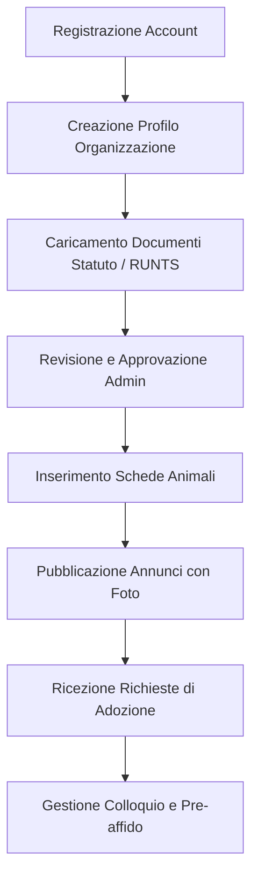

# Guida Operativa Pilota — Rifugi Partner del Lazio

Benvenuti nel programma pilota di **Tailor**, la piattaforma trasparente e verificata dedicata alle adozioni di animali nel Lazio.

Questo documento illustra il funzionamento della piattaforma per i rifugi e le associazioni partner che partecipano alla fase pilota (Milestone 15).

---

## 1. Obiettivi della Fase Pilota

- Validare il percorso di verifica documentale delle associazioni animaliste (RUNTS, registri regionali del volontariato).
- Testare l'inserimento e la pubblicazione di annunci conformi alla normativa italiana sul benessere animale (L. 281/1991, normativa regionale del Lazio).
- Verificare il flusso di contatto e messaggistica tra cittadini adottanti e referenti del rifugio.
- Raccogliere feedback sull'usabilità per perfezionare la piattaforma prima del lancio pubblico.

---

## 2. Rifugi Partner Coinvolti

Il test pilota coinvolge 5 realtà partner rappresentative di 4 province del Lazio:

1. **Rifugio Muratella** (Roma, RM) — Struttura comunale / convenzionata
2. **Oasi Felina di Porta Portese** (Roma, RM) — Associazione tutela colonie feline (ETS)
3. **ENPA Sezione Provinciale di Viterbo** (Viterbo, VT) — Rifugio canino Tuscia
4. **Associazione Animalista Amici a 4 Zampe Rieti** (Rieti, RI) — Associazione ODV
5. **Rifugio San Francesco Latina** (Latina, LT) — Canile rifugio Agro Pontino (APS)

---

## 3. Requisiti di Conformità e Tutela Legale

Per garantire la massima sicurezza ed escludere il commercio illegale, Tailor applica controlli stringenti a livello di database e codice:

- **Età minima per l'adozione:** Gli animali devono avere almeno **60 giorni** (svezzamento completato, L. 281/91).
- **Microchip obbligatorio per i cani:** Codice a **15 cifre** rispondente agli standard ISO 11784/11785 (prefisso Italia 380 o codice produttore autorizzato dal Ministero della Salute).
  - *Nota riservatezza:* Il numero di microchip è crittografato e **mai visibile pubblicamente** agli utenti anonimi. È accessibile esclusivamente al rifugio proprietario e agli amministratori della piattaforma.
- **Gratuità dell'adozione:** Gli annunci di adozione sono a titolo gratuito o con eventuale rimborso spese vive documentato (la vendita a scopo di lucro è tassativamente inibita).
- **Trasparenza sanitaria:** Indicazione chiara dello stato di sterilizzazione, vaccinazioni eseguite e test diagnostici (es. Leishmania per cani, FIV/FeLV per gatti).

---

## 4. Flusso Operativo del Rifugio



### Passo 1: Registrazione e Onboarding
1. Accedere all'ambiente di test / staging con le credenziali fornite.
2. Accedere alla sezione **"Crea Organizzazione"** (`/organizations/new`).
3. Inserire i dati statutari: Denominazione Legale, Codice Fiscale / Partita IVA, Comune della sede operativa nel Lazio, recapiti telefonici ed email di contatto.
4. Caricare la copia del documento di iscrizione al Registro Unico Nazionale del Terzo Settore (RUNTS) o all'Albo Regionale delle Associazioni di Volontariato.

### Passo 2: Verifica e Abilitazione
- Il team di moderazione Tailor verifica i documenti entro 24 ore.
- Una volta verificata (`verification_status = 'verified'`), l'organizzazione riceve il badge di **"Rifugio Verificato"** e l'abilitazione alla pubblicazione immediata degli annunci.

### Passo 3: Creazione e Gestione Schede Animali
1. Dalla dashboard del rifugio, cliccare su **"Nuovo Animale"** (`/my-animals/new`).
2. Compilare le informazioni identificative:
   - Nome, specie (cane o gatto), sesso, data di nascita stimata o esatta, taglia.
   - Carattere e compatibilità: bambini, altri cani, gatti, vita in appartamento.
   - Storia e descrizione dettagliata (minimo 30 caratteri).
   - Numero di microchip (protetto da RLS).
   - Stato sanitario: vaccinazioni, sterilizzazione, note veterinarie.
3. Caricare da 1 a 8 fotografie di buona qualità con testo alternativo descrittivo.
4. Cliccare su **"Pubblica Annuncio"**.

### Passo 4: Gestione Richieste di Adozione
- Quando un cittadino interessato invia una richiesta tramite il form presente sulla scheda animale, il rifugio riceve una notifica email e un nuovo thread nella sezione **"Richieste"** (`/inquiries`).
- Il rifugio può dialogare con l'adottante, richiedere informazioni aggiuntive sul contesto familiare e organizzare la visita pre-affido.

---

## 5. Caricamento Dati Dimostrativi Pilota

Per testare l'ambiente locale o di staging con i dati dei 5 rifugi e gli 8 annunci già configurati:

```bash
# Esecuzione del seed pilota sul database
bun run db:seed:pilot
```

Oppure eseguendo lo script SQL direttamente dalla dashboard Supabase o CLI:
```bash
supabase db execute --file supabase/seed_pilot_lazio.sql
```

---

## 6. Segnalazione Bug e Canale di Supporto Pilota

Durante la fase pilota, qualsiasi anomalia, difficoltà di interfaccia o proposta di miglioramento può essere inoltrata tramite:

- **Repository GitHub:** [GitHub Issues](https://github.com/Lorenzo2703/Tailor/issues) (etichetta `pilot-feedback`)
- **Email di contatto supporto pilota:** `pilota-lazio@tailor.pet`
- **Banner superiore di Staging:** pulsante rapido *"Segnala feedback"* sempre accessibile da ogni pagina.
